# Lab 1 · The OS as a Resource Manager

**Sergiu Gherasim, FAF-242** · Technical University of Moldova, FCIM · Operating Systems · Laboratory work no. 1

The formatted report is [`lab1-report.tex`](lab1-report.tex).

## Purpose of the work

Watch the operating system do its four core jobs (managing files, processes, memory and devices) from the terminal of a Linux virtual machine, and write down what each command shows.

I used a Debian 13 VM (6 CPU cores, 4 GB of RAM) running in UTM.

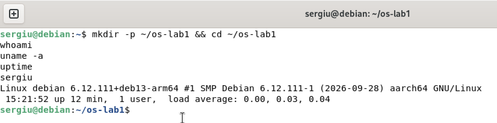

I am `sergiu`, the kernel is Linux 6.12 (`6.12.111+deb13-arm64`) on `aarch64`, and the VM had been up for 12 minutes with load averages near 0, so it was idle.

## Part 1. Files and directories

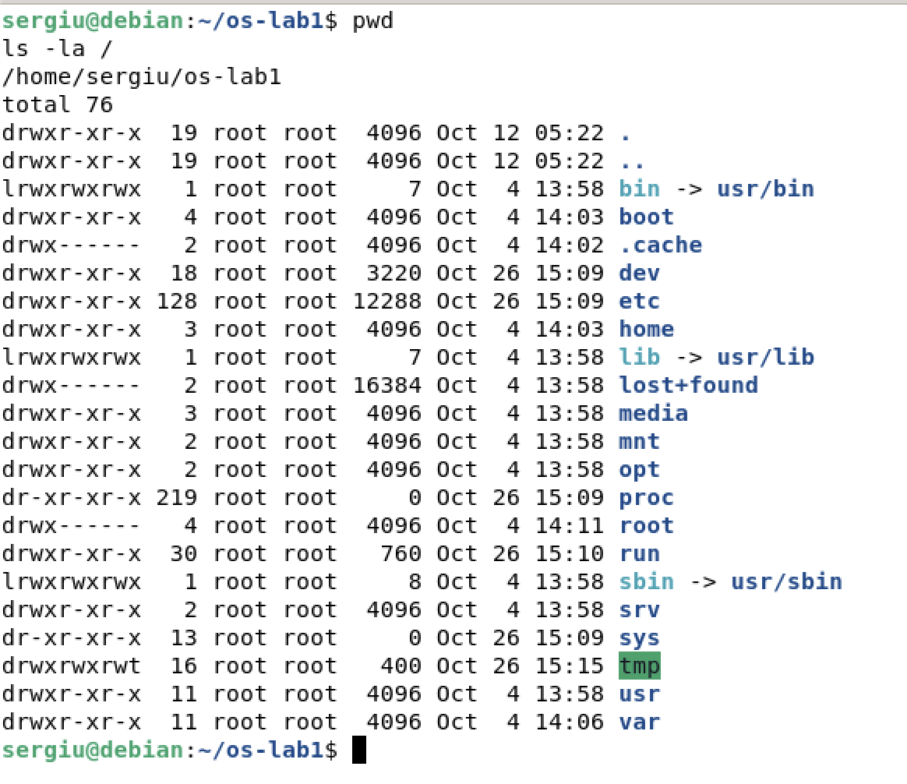

Everything under `/` belongs to `root`. `/bin`, `/lib` and `/sbin` are symbolic links into `/usr`. `/proc` and `/sys` have size 0 because the kernel generates them; they aren't on the disk.

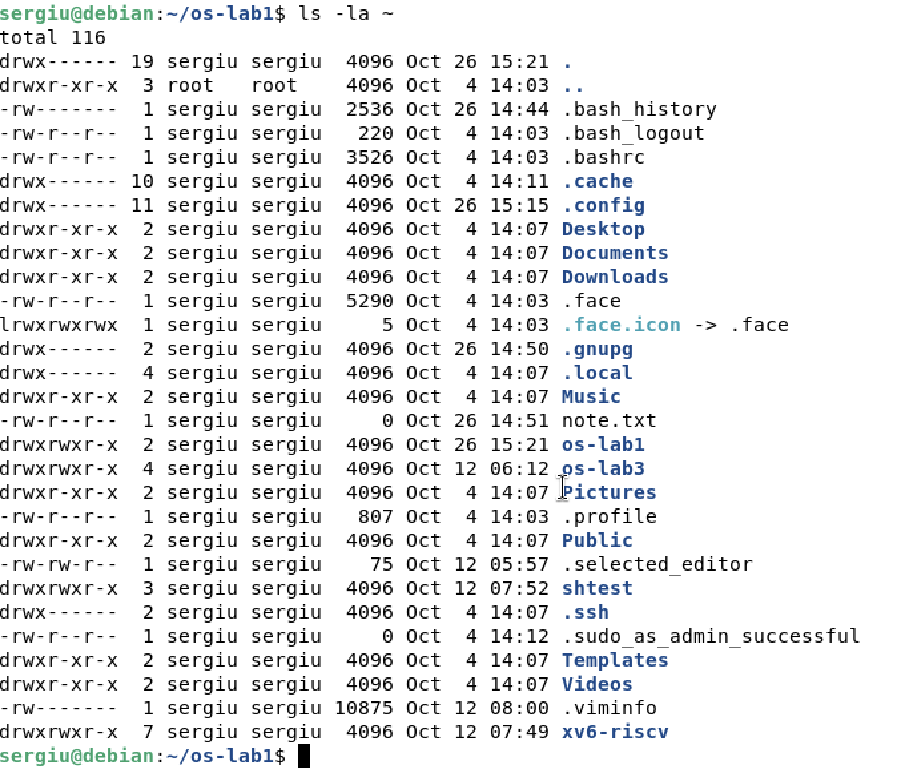

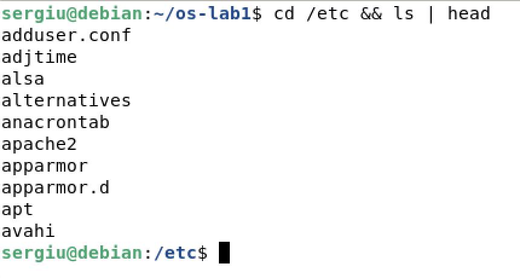

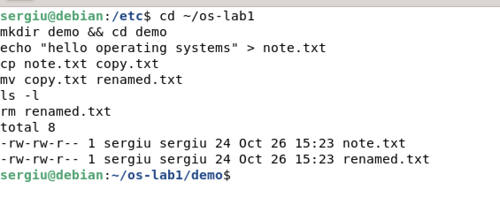

`mv` doesn't copy any data inside the same file system. It only changes the name stored in the directory, so it's instant even for big files.

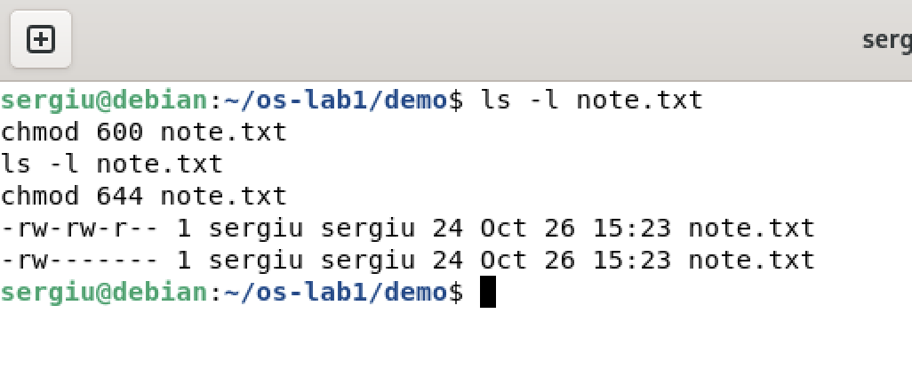

The file was created as `-rw-rw-r--` because my umask is `0002`. `chmod 600` leaves read and write only for the owner. `chmod 644` gives `-rw-r--r--`.

### Observe

1. **Who owns the files, and which group?** The user `sergiu` and the group `sergiu`. Debian gives every user a private group with the same name.
2. **What do the ten characters mean after `chmod 600`?** `-rw-------`: `-` is a regular file, `rw-` means the owner can read and write, and the group and others (`---` and `---`) have no rights.
3. **Two directories under `/`:** `/etc` holds the system-wide configuration files. `/home` holds the users' home directories.

## Part 2. Processes

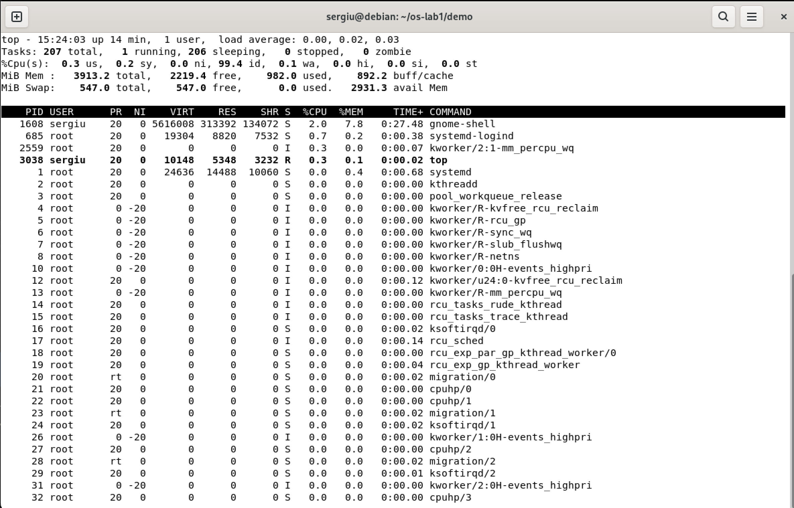

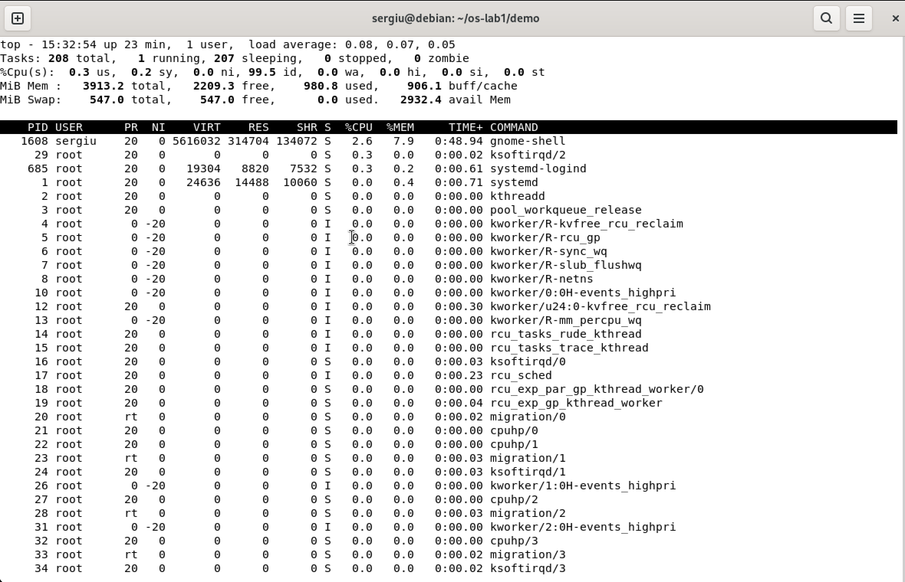

The idle VM had 208 tasks: 1 running (`top` itself) and 207 sleeping. The CPU was 99.5% idle. The busiest process was `gnome-shell`, the desktop. Most lines are kernel threads (`kworker`, `ksoftirqd`, `migration`) that use no memory of their own.

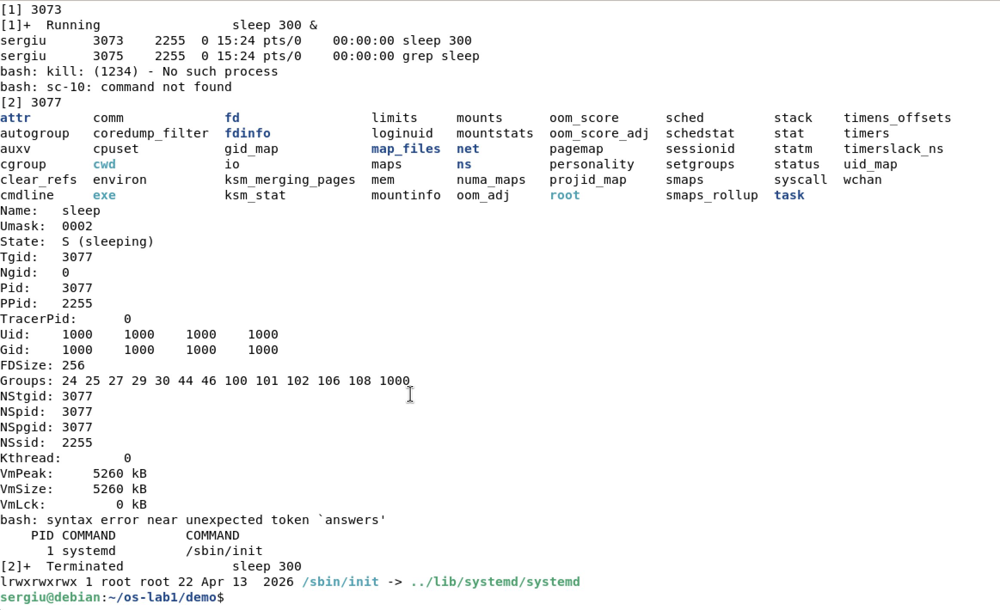

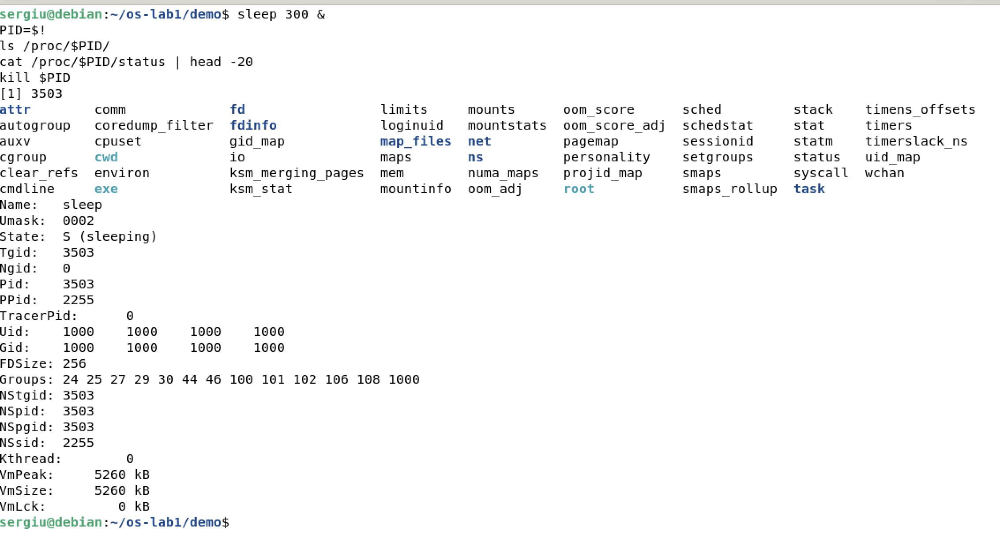

`/proc/<PID>` isn't stored on disk; the kernel generates it when it's read. `status` shows the process name, state, PID (3503), parent PID (2255, my bash), my UID 1000 and the virtual size (5260 kB).

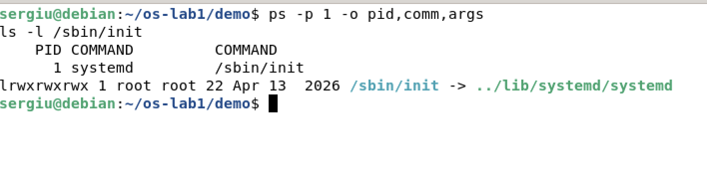

### Observe

1. **What is PID 1?** `systemd`, started as `/sbin/init`, which is a link to `/lib/systemd/systemd`. The kernel starts it at the end of boot. It starts every other service and adopts orphaned processes.
2. **How many processes on the idle VM?** About 208. `htop` splits them into 109 user processes and 101 kernel threads.
3. **The `State:` line of the sleeping process:** `S (sleeping)`. It waits for its timer and uses no CPU until the kernel wakes it.

## Part 3. Memory

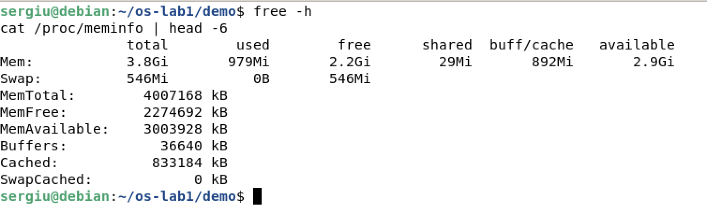

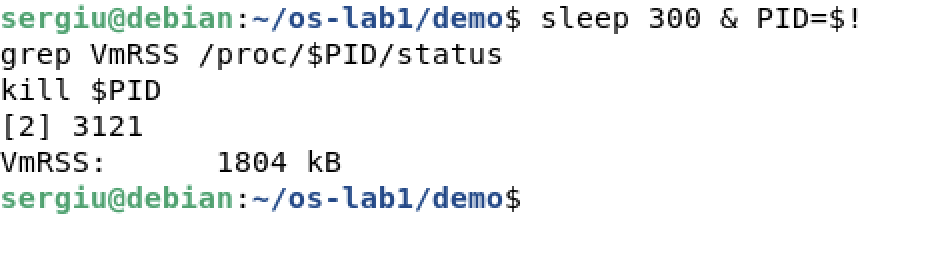

### Observe

1. **Total and free RAM:** 3.8 GiB total, 979 MiB used, 2.2 GiB free and 2.9 GiB available. "Available" also counts file cache that the kernel can release when needed.
2. **What is swap, and how much is there?** Swap is disk space where the kernel moves rarely used pages when RAM runs out. It's slower, but programs keep running. This VM has 546 MiB of swap on the partition `vda4`, and 0 B of it is used.
3. **VmRSS of a bare `sleep`:** 1804 kB, about 1.8 MiB. It surprised me at first, but even an idle program has its code, stack and the C library mapped into memory. Most of those pages are shared with other processes.

## Part 4. Devices and storage

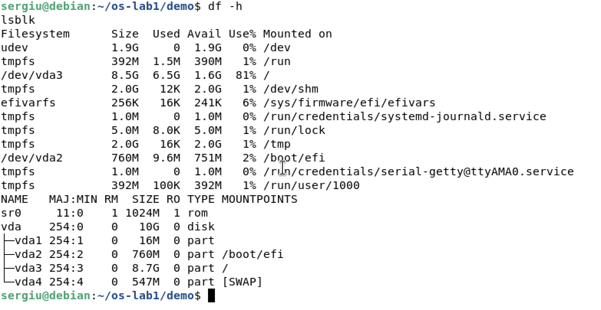

`lsblk` shows a 10 GB virtual disk `vda` with partitions for `/boot/efi` (`vda2`), `/` (`vda3`) and swap (`vda4`). The root file system is 81% full. `tmpfs` and `udev` from `df` live in RAM, not on a disk.

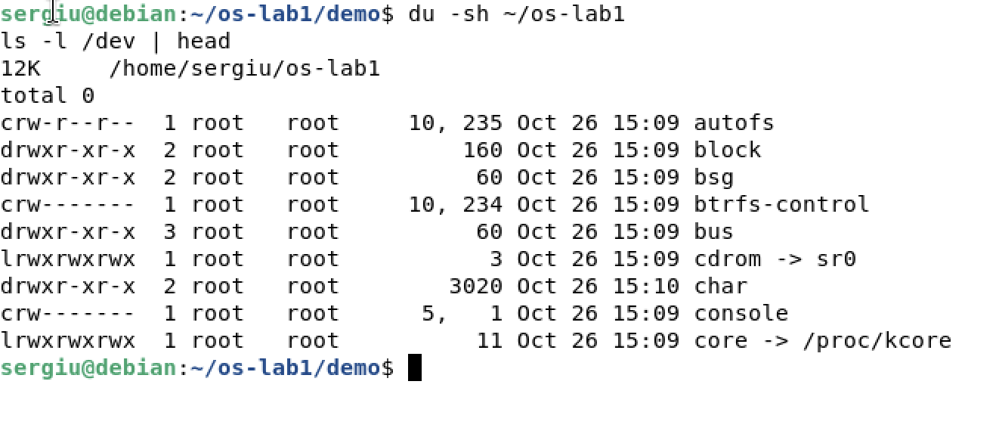

My work folder takes 12K: three 4 KB blocks. In `/dev`, `c` marks a character device and `b` a block device. Instead of a size, a device shows its major and minor numbers (`5, 1` for `console`), which tell the kernel which driver handles it.

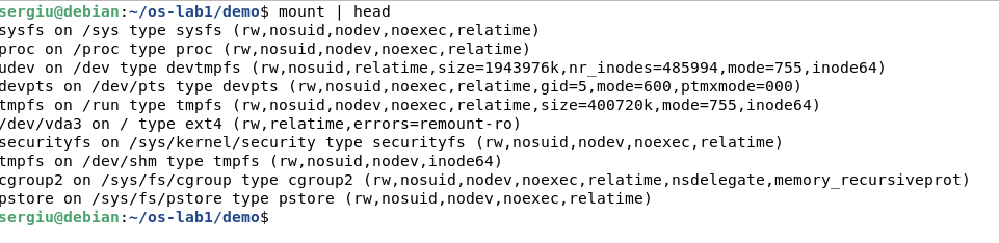

### Observe

1. **Device of `/`:** `/dev/vda3`, an `ext4` partition of the VM's virtual disk.
2. **One entry from `/dev`:** `/dev/vda` is the whole virtual hard disk; reading it gives the raw bytes underneath any file system. `/dev/null` discards everything written to it.
3. **"Everything is a file":** disks, terminals, processes and kernel information all appear as names in the same tree (`/dev`, `/proc`, `/sys`). You use them with the same `open`/`read`/`write`/`close` as ordinary files.

## Finished early

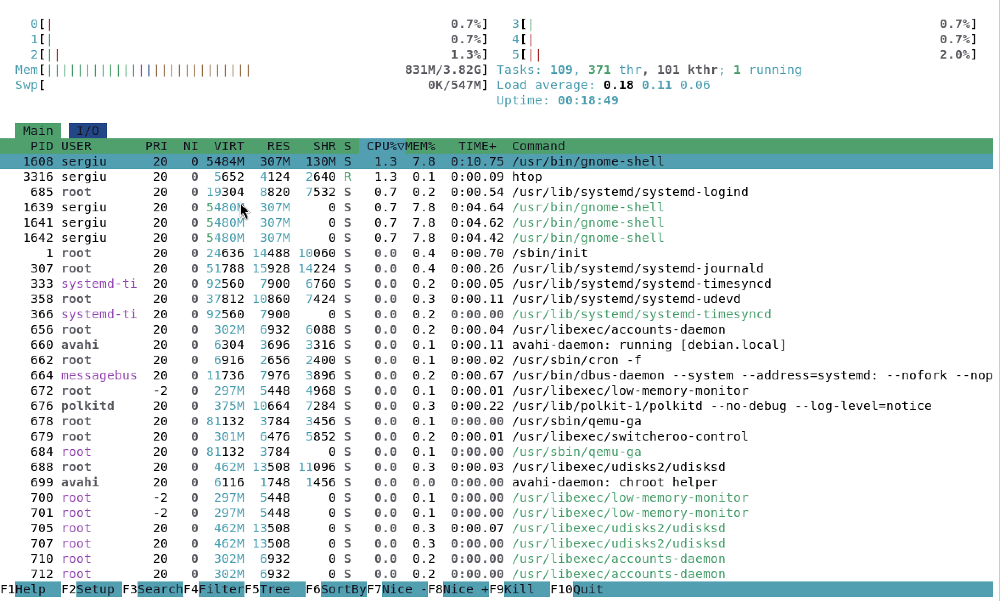

`htop` shows a bar for each of the 6 cores and for memory and swap. It also separates the 109 user processes from the 101 kernel threads.

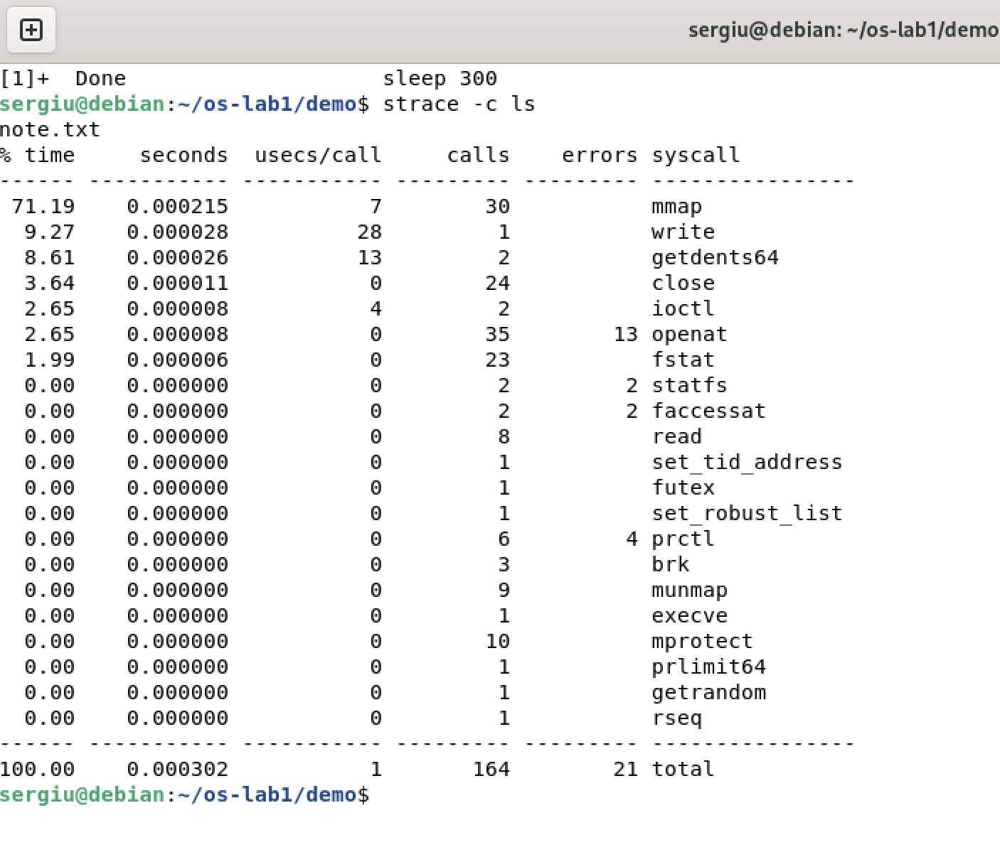

Listing a directory with one file took 164 system calls of 21 kinds, and 21 of them failed. Almost all of them prepare the program: `execve` loads it, and 35 `openat`, 30 `mmap` and 24 `close` calls load the shared libraries and locale files. The 13 failed `openat` calls are files that were looked for but don't exist. The actual work is 2 `getdents64` calls to read the directory and 1 `write` to print `note.txt`.

## Conclusion

The operating system manages four resources: files, processes, memory and devices. I saw **files** with `ls -l`, which shows the owner and permissions the OS keeps for every name in the tree, and **processes** with `ps aux`, which lists every program the OS has created and is scheduling. I saw **memory** with `free -h`, which shows how the OS shares the physical RAM and swap, and **devices** with `lsblk`, which shows the disks the OS hides behind file-like names in `/dev`.
