# Lab 2 · Meet the OS You Will Build

**Sergiu Gherasim, FAF-242** · Technical University of Moldova, FCIM · Operating Systems · Laboratory work no. 2

The formatted report is [`lab2-report.tex`](lab2-report.tex).
The source code of the user program is [`sleep.c`](sleep.c).

## Purpose of the work

- Build the xv6 kernel with a RISC-V cross-compiler and boot it under QEMU.
- Use xv6 as a minimal Unix: run its programs, use a pipe, run the test suite.
- Read the source of a user program and find the system calls in the kernel.
- Write a new user program (`sleep`), add it to the build and test it inside xv6.

I worked on the Linux virtual machine of the course, which already has the toolchain. The submitted files are `user/sleep.c` and the modified `Makefile`; the answers to the two *Observe* boxes are in this file.

## Part 1. Build and boot xv6

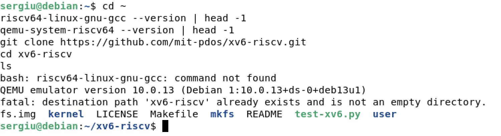

`riscv64-linux-gnu-gcc` is a normal GCC that produces code for another processor, so the kernel can be built without a RISC-V computer, and `qemu-system-riscv64` is the emulator that runs it. After `git clone` the tree holds `kernel/`, `user/`, the `Makefile` and the `README`.

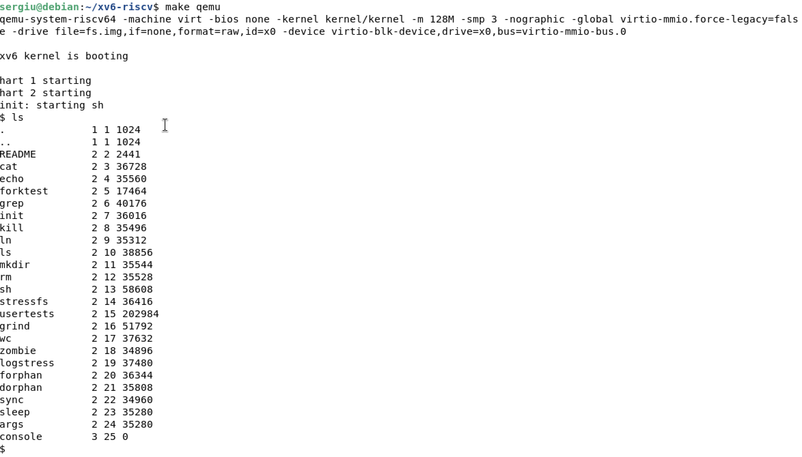

`make qemu` builds `kernel/kernel` and every program in `UPROGS`, then `mkfs` packs them with `README` and the device files into the disk image `fs.img`, and QEMU starts. xv6 prints `xv6 kernel is booting`, `init` prints `init: starting sh`, and the shell prompt is `$`. The `ls` after it runs inside xv6 and lists the files of `fs.img`, not the Linux tree.

To leave QEMU: `Ctrl-A`, then `X`. That sequence belongs to QEMU, not to xv6 — the shell has no exit command.

## Part 2. Using xv6 as a Unix

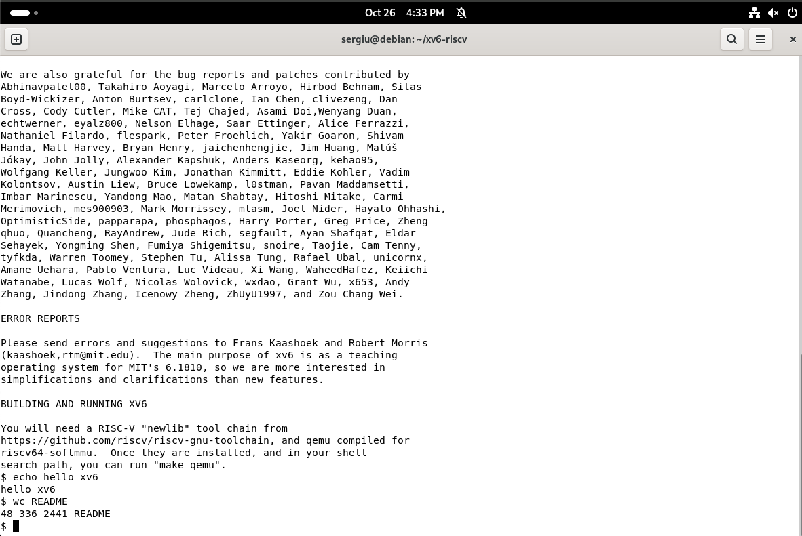

`cat README` opens the file, copies it in blocks into a buffer and writes each block out. `echo hello xv6` prints its arguments. `wc README` prints the lines, words and bytes of the file (48, 336 and 2441), followed by its name.

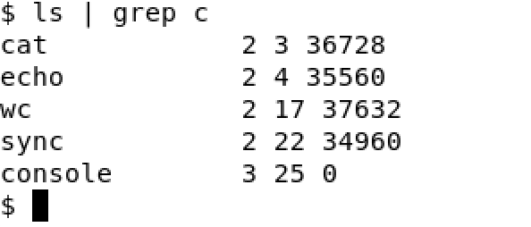

The shell creates a pipe with the `pipe` system call and gets two descriptors, one to write and one to read. It then calls `fork` twice and each child replaces itself with `exec`: the left program writes into the pipe, the right one reads from it. Neither program knows about the other.

### Observe

1. **List three programs xv6 ships with.** `cat`, `echo`, `wc`. The full list is `UPROGS` in the `Makefile`, and the source of each one is a small file in `user/`.
2. **Which two OS features must exist for a pipe to work?** Processes and inter-process communication. The pipe only makes sense between two processes running at the same time, so the kernel must create (`fork`), schedule and run them. And because they have separate address spaces, they cannot share a buffer: the kernel owns the channel and copies the bytes through it.
3. **How does the xv6 shell compare to the Linux shell from Lab 1?** It is much smaller: the same basic commands and pipes work, but there are far fewer of them (`clear` does not exist), there is no history or completion, and it is noticeably slower, because every program is started with a fresh `fork` and `exec` on an emulated processor.

## Part 3. Reading the source

`kernel/` is the system itself: it runs privileged, keeps the page table, schedules processes, stores files and handles system calls. `user/` holds ordinary unprivileged programs that run on top of it.

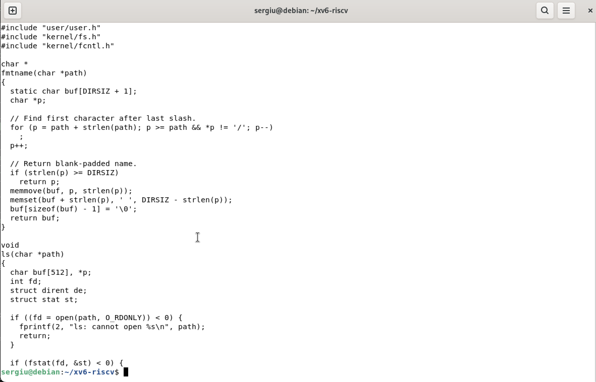

`user/ls.c` is a whole `ls` in about a hundred lines: `main` calls `ls` for every path, and `ls` opens the directory, reads its entries block by block and prints a name for each one, asking `stat` for the type and the size. `fmtname` and `ls` are local, but `open`, `read`, `close` and `fstat` are system calls declared in `user/user.h`.

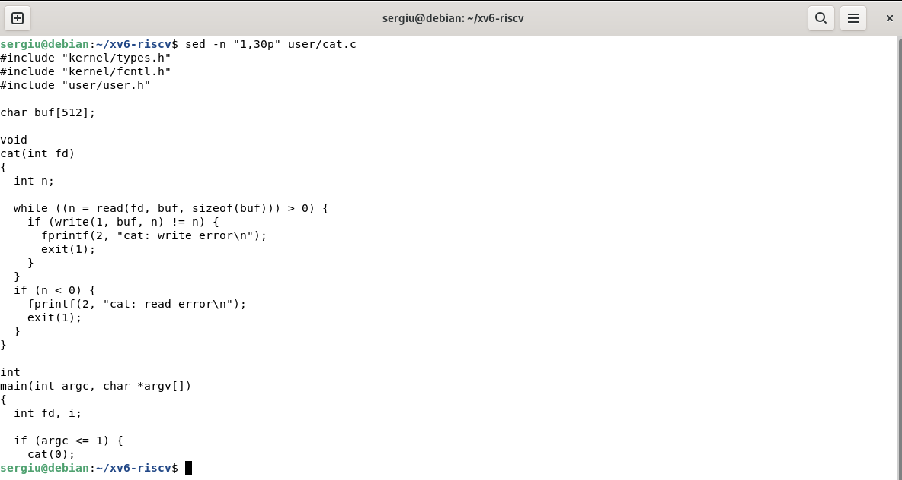

`user/cat.c` does one thing in a loop: `read` a block into a buffer, `write` it to descriptor 1, repeat until `read` returns 0. On an error it prints on descriptor 2 and exits with status 1.

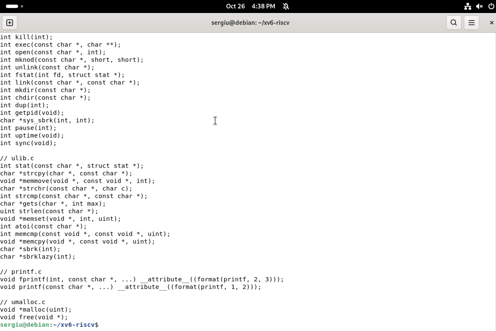

`user/user.h` is the contract between the two folders: it declares the library helpers and every system call a program may make. These functions have no body in `user/`; `user/usys.S` turns each one into a few instructions that put the call number in a register and execute `ecall`, which switches into supervisor mode and jumps into the kernel.

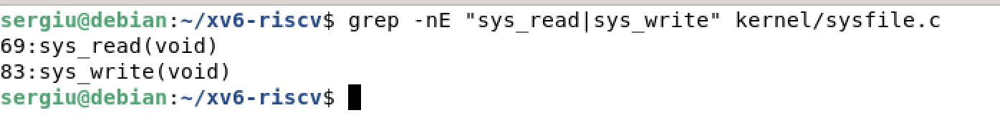

`kernel/syscall.c` reads the call number and dispatches through the table `syscalls`. The file system calls are in `kernel/sysfile.c`; `sys_read` gets its arguments with `argfd` and `argaddr`, then calls `fileread` on the open file.

### Observe

1. **Which system calls does `user/cat.c` use?**
   - `open` — find the named file, check permissions, return a file descriptor.
   - `read` — copy the next bytes of an open file into a buffer of the process.
   - `write` — copy bytes from a buffer to an open file (here the terminal).
   - `close` — release the descriptor so its number can be used again.
   - `exit` — terminate the process and give its status to the parent.
2. **In which kernel file, and on which line, is `sys_read` implemented?** In `kernel/sysfile.c`, at line 69; the next function, `sys_write`, is at line 83. The numbers move when the file changes, so one searches for the name rather than remembering the line.
3. **What is the difference between `kernel/` and `user/`?** `kernel/` is the operating system itself — privileged, it owns the hardware and cannot be removed without the machine stopping — while `user/` holds ordinary programs that run unprivileged on top of it and can be replaced or deleted freely.

## Part 4. Adding a user program

The kernel already implements the call that pauses a process: it takes a number of ticks, marks the process as sleeping and calls the scheduler until the timer wakes it. In the current `xv6-riscv` this call is named `pause`; it was called `sleep` until August 2025, when it was renamed to avoid confusion with the program (older copies of the tree, like the one the task sheet was written for, still show `sleep`).

```c
#include "kernel/types.h"
#include "user/user.h"

int
main(int argc, char *argv[])
{
  if(argc != 2){
    fprintf(2, "usage: sleep <ticks>\n");
    exit(1);
  }
  pause(atoi(argv[1]));   // system call into the kernel
  exit(0);
}
```

`argc` counts the words of the command line, including the program name, so a correct call has `argc == 2`. `atoi` turns `argv[1]` into the number the system call needs. `fprintf(2, ...)` writes the usage message on standard error and `exit(1)` reports failure.

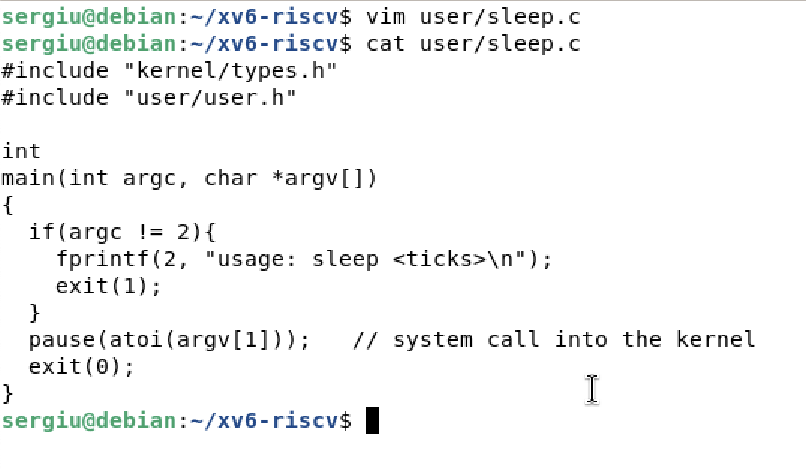

A file in `user/` is not compiled by itself: only the programs in `UPROGS` are built. Each line is `$U/_name\`, the indentation is a tab, and the list is one command continued from line to line.

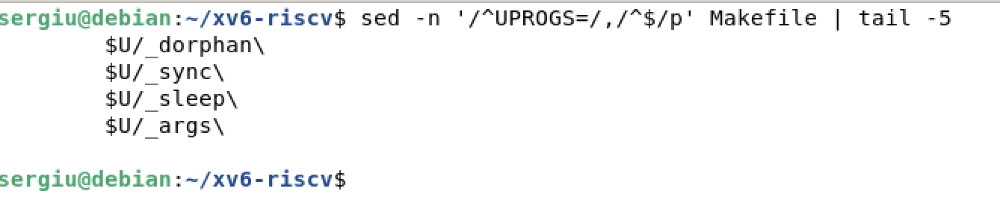

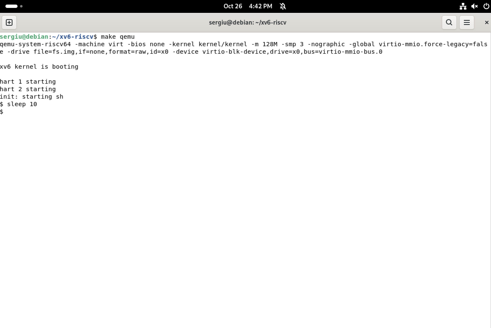

After `make qemu`, `sleep` appears in `ls` like the other programs. `sleep 10` returns to the prompt after ten clock ticks without printing anything: the process really stopped and the scheduler ran something else meanwhile.

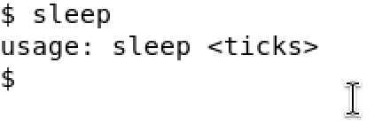

With no argument `argc` is 1, the program takes the error branch, prints `usage: sleep <ticks>` and exits with status 1. The shell just shows the next prompt, because xv6 does not print exit statuses by default.

## Conclusion

Building the system from source reverses the view of Laboratory Work No. 1. On Linux I could only see programs from the outside, through `ps` and `/proc`; in xv6 I can read both sides of the same request: the program in `user/` calls `read` or `pause`, the stub executes `ecall`, the kernel looks the call up in its table and runs `sys_read` or `sys_pause`.

The pipe showed the two features that make this cooperation useful: processes, created and scheduled by the kernel, and inter-process communication, a channel the kernel owns because the processes cannot share memory. Writing `sleep` closed the circle: a new file in `user/`, one tab-indented line in `UPROGS`, and a program that is part of the system that is built and booted.
