# Lab 4 · The xv6 Shell from the Outside

**Sergiu Gherasim, FAF-242** · Technical University of Moldova, FCIM · Operating Systems · Laboratory work no. 4

The formatted report is [`lab4-report.tex`](lab4-report.tex).
The source files are [`sleep.c`](sleep.c), [`args.c`](args.c), [`args_linux.c`](args_linux.c) and the [`Makefile`](Makefile).

## Purpose of the work

- Fix the `sleep` program for the current xv6, where the system call is called `pause`.
- Run the same commands in bash and in the xv6 shell and compare what they do.
- Write `args`, the same program for xv6 and for Linux, to see which arguments each shell passes.
- Read `user/sh.c` and find the five kinds of command, `runcmd` and the `cd` built-in.

I used the course Linux VM and the same `xv6-riscv` tree as in the previous labs.

## Part 1. Fixing sleep for the current xv6

In August 2025 the xv6 authors renamed the `sleep` system call to `pause`, so the program from Lab 2 no longer compiles. First ask the tree which name it uses:

```text
$ grep -n "pause\|sleep" user/user.h
int pause(int);
```


My tree declares `pause`, so only the call inside the program changes. The program keeps the name `sleep`, because that is the name the course gives it and the one that has to be in `UPROGS`.

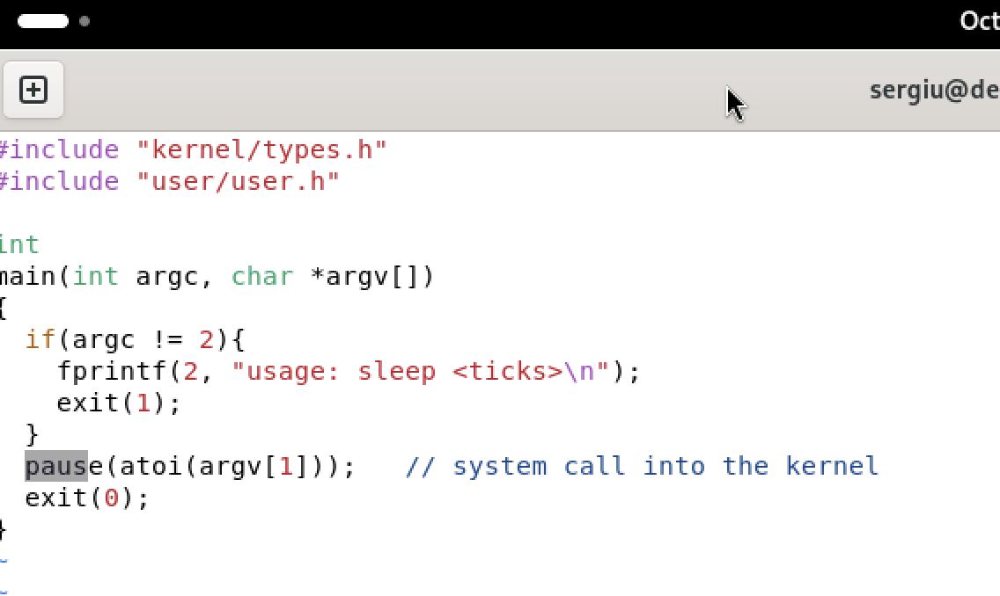

```c
#include "kernel/types.h"
#include "user/user.h"

int
main(int argc, char *argv[])
{
  if(argc != 2){
    fprintf(2, "usage: sleep <ticks>\n");
    exit(1);
  }
  pause(atoi(argv[1]));   // was sleep() before August 2025
  exit(0);
}
```

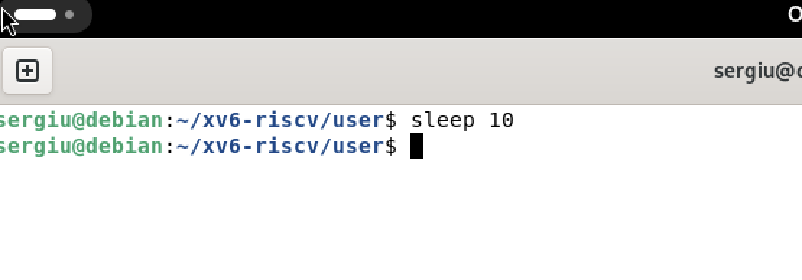

With one argument the program waits for that many ticks and returns to the prompt without printing anything. Without an argument `argc` is 1, so it prints `usage: sleep <ticks>` and exits with status 1 instead of reading a missing argument.

## Part 2. bash versus the xv6 shell

Every command was run twice: in bash inside an empty folder that contains a `README`, and at the xv6 prompt.

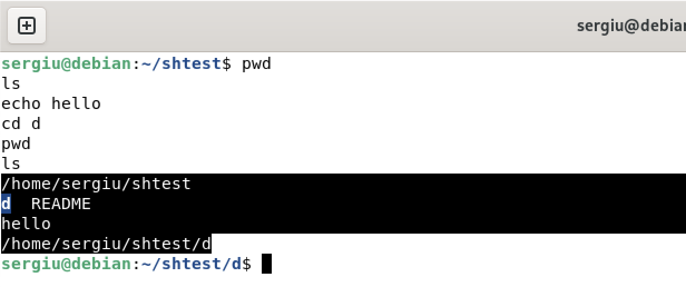

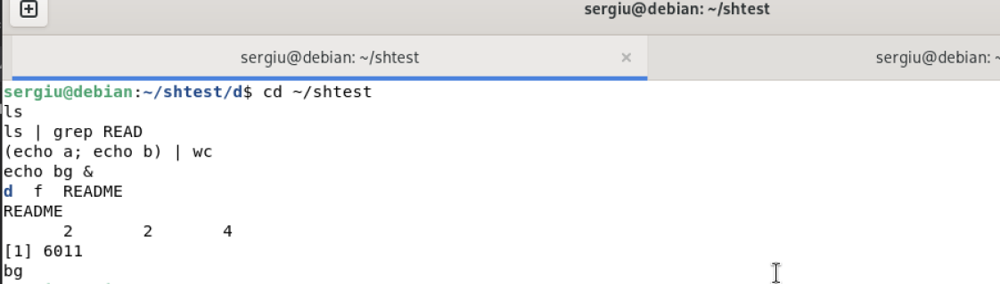

In bash `pwd`, `ls` and `echo` work as expected. A pipe connects the output of one program to the input of the next, so `ls | grep READ` keeps only `README`, and `(echo a; echo b) | wc` counts the output of a group. A trailing `&` puts the command in the background and bash prints a job number.

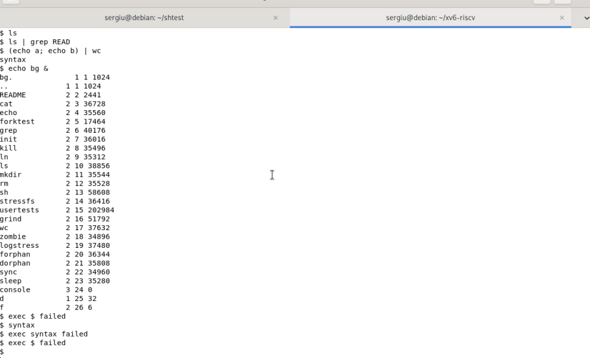

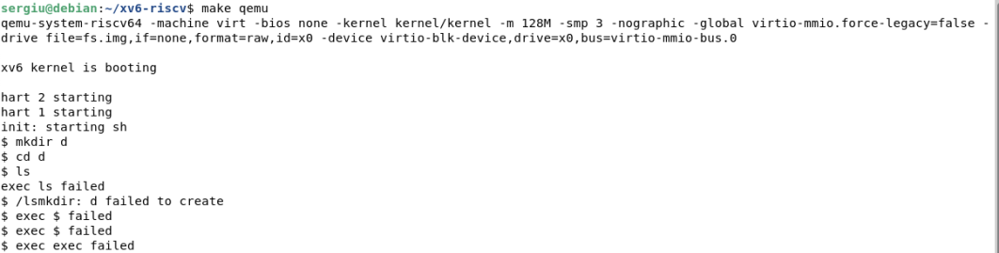

xv6 runs the same programs, but its shell does much less around them. Its `ls` prints name, type, inode and size, so `ls | grep READ` shows more than bash. There is no globbing, no variable expansion and no quote removal, and the shell cannot read a command that continues on a second line.

| Command | Tests | bash | xv6 |
|---|---|---|---|
| `echo hello > f ; cat < f` | redirection | works | works |
| `ls \| grep READ` | pipe | prints `README` | works, but prints name, type, inode and size |
| `(echo a; echo b) \| wc` | grouping, list | `2 2 4` | `syntax`: no multi-line commands |
| `echo one ; echo two` | sequence | `one`, then `two` | `one`, then `two` |
| `echo bg &` | background | `[1] 6011` and `bg` | `bg` |
| `ls *` | globbing | `f README` | `ls: cannot open *` |
| `echo $HOME` | variables | `/home/sergiu` | `$HOME` |
| `echo "a b"` | quotes | `a b` | `"a b"` |
| `mkdir d ; cd d ; ls ..` | PATH | `d f README` | `exec mkdir failed`, `exec cd failed` |
| arrow up, Tab, Ctrl+R | history, completion | work | do not work |

### Observe

1. **Which features do both shells have, and which only bash?** Both execute programs, connect them with pipes (`|`), redirect input and output (`<`, `>`), run commands in the background (`&`), group them with `()`, run them in sequence with `;` and change directory with `cd`. Only bash has history, tab completion, variables and `$` expansion, `PATH` lookup, job control, command substitution and a scripting language.
2. **Why does `ls` stop working after `cd d`, and how can it be run from inside `d`?** Because xv6 has no `PATH`. A name without a slash is looked up in the current directory only, and after `cd d` the current directory is the empty `d`. The absolute path `/ls` works, because a name that starts with a slash is resolved from the root, where the programs of `fs.img` live.
3. **Which missing feature would you miss most, and which would be easiest to add?** History and tab completion, because they are used in every command. History would be the easiest: the shell already reads lines in `getcmd`, so it could keep them in a buffer and let the arrow keys walk through it.

## Part 3. Who expands `*`?

The same program twice: for xv6 with the two xv6 headers and `exit`, added to `UPROGS`; for Linux with `stdio.h` and `return 0`.

```c
// user/args.c (xv6)
#include "kernel/types.h"
#include "user/user.h"

int main(int argc, char *argv[]) {
  printf("argc = %d\n", argc);
  for (int i = 0; i < argc; i++)
    printf("argv[%d] = [%s]\n", i, argv[i]);
  exit(0);
}
```

```c
// args_linux.c
#include <stdio.h>

int main(int argc, char *argv[]) {
  printf("argc = %d\n", argc);
  for (int i = 0; i < argc; i++)
    printf("argv[%d] = [%s]\n", i, argv[i]);
  return 0;
}
```

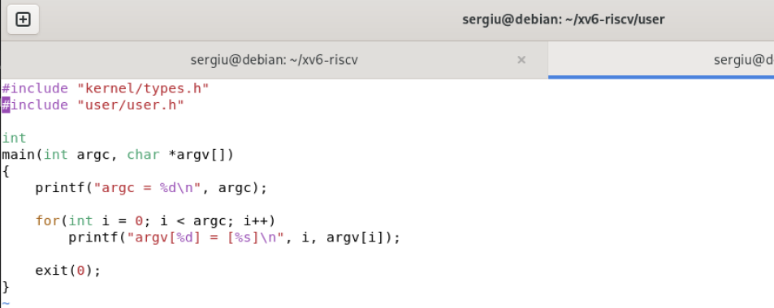

The Linux version is compiled with `gcc -o args args_linux.c` and started as `./args`, because the current directory is not in `PATH`. In xv6 it is started as `args`, because every program lives in the directory the shell is in.

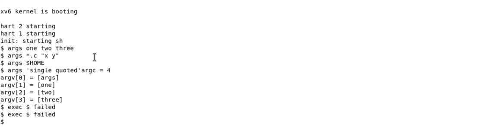

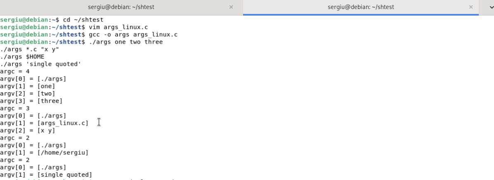

### Observe

1. **Paste both outputs for `args *.c "x y"`.** Bash receives 3 arguments, xv6 receives 4:
   ```text
   argc = 3                    argc = 4
   argv[0] = [./args]          argv[0] = [args]
   argv[1] = [args_linux.c]    argv[1] = [*.c]
   argv[2] = [x y]             argv[2] = ["x]
                               argv[3] = [y"]
   ```
   Bash replaced the pattern with a file name and joined `"x y"` into one word; xv6 kept the star and both quotes as ordinary characters.
2. **Who turns `*.c` into file names and removes the quotes: the program, the kernel or the shell?** The shell. The program only receives the finished list of words, and the kernel only copies that list into the new process when `exec` runs. The same binary prints a file name under bash and a literal star under xv6, so the change happened before the program started.
3. **What happened to the extra spaces in `one two three`?** They disappear before the program runs: a run of unquoted spaces is one separator, so the program receives three arguments and cannot tell how many spaces were typed. Both shells behave the same way.

## Part 4. Reading the shell

The shell is one loop in `main`: read a line with `getcmd`, parse it into a tree, run the tree, repeat.

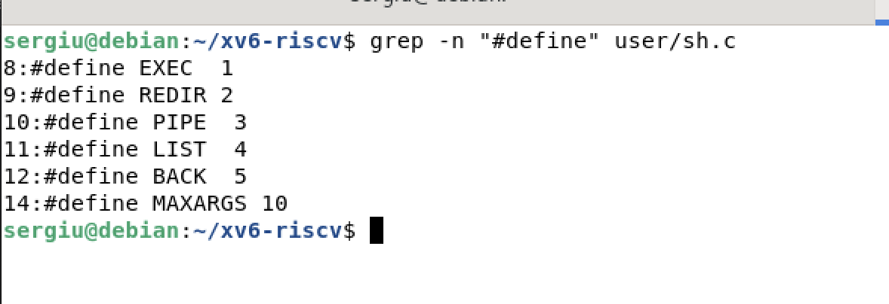

`user/sh.c` has about 500 lines. The five kinds of command are numbered constants, and each kind is a struct that points to its parts: `execcmd` holds the argument vector, `redircmd` the file to open, and the pipe, list and background commands point to the commands they connect.

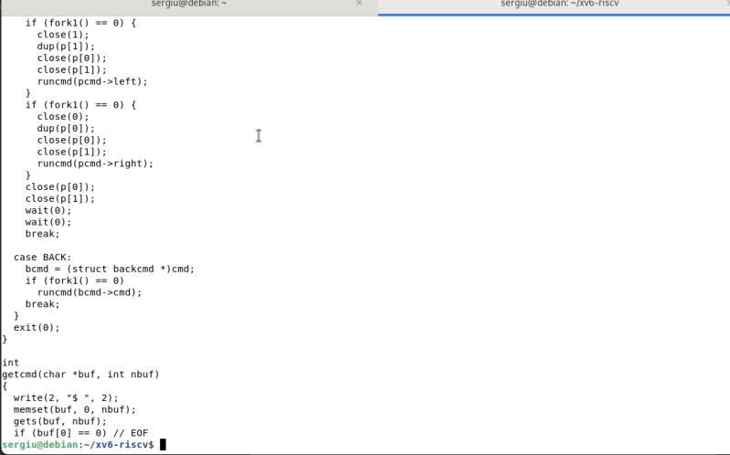

`runcmd` is a `switch` over the kind. `EXEC` calls `exec`; `REDIR` opens the file, replaces the right descriptor with `dup` and runs the inner command; `PIPE` creates a pipe, forks twice and gives each child one end; `LIST` runs the left command, waits, then the right one; `BACK` runs the left command in a child without waiting.

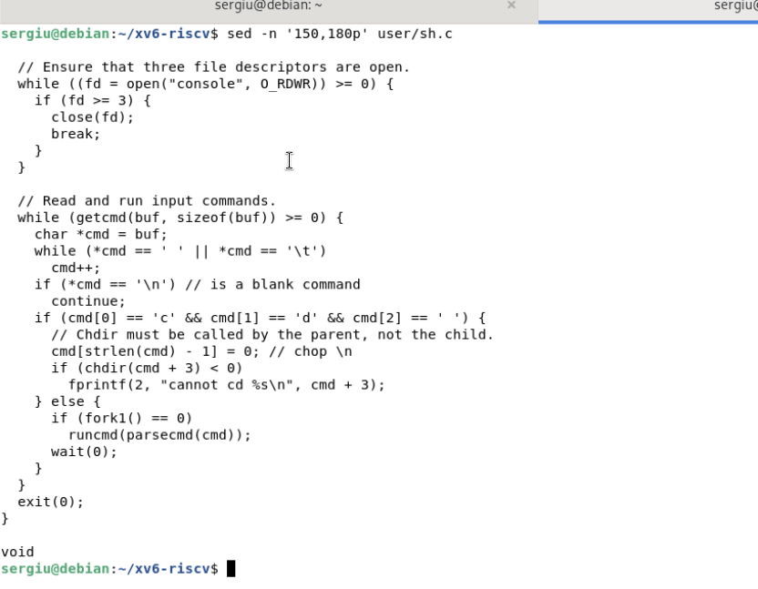

### Observe

1. **Name the five kinds of command and the character that produces each.** `EXEC` (plain command), `REDIR` (`<`, `>`, `>>`), `PIPE` (`|`), `LIST` (`;`) and `BACK` (`&`), defined as 1 to 5 at the top of `user/sh.c` together with `MAXARGS = 10`.
2. **Where is `cd` handled, and why not as a separate program?** In the `main` loop of `user/sh.c`, before parsing: a line that starts with `cd ` is handled with `chdir` and `continue`. A separate program would run as a child with its own copy of the working directory; it would change that copy and exit, leaving the shell where it was. The change must happen in the shell process itself.
3. **Is there code that handles `*` or `$`?** No. The parser only knows spaces, the redirection characters, `|`, `;`, `&` and parentheses, so a star or a dollar sign is copied into the argument vector like any other character. That is why `ls *` asks for a file named `*` and `echo $HOME` prints `$HOME`.

## Conclusion

The same commands showed that xv6 and bash share the core of the Unix interface — programs, pipes, redirection, sequences, groups and background jobs — while bash adds what makes a shell comfortable: history, completion, variables, `PATH` and scripting. The `args` program separated the responsibilities: wildcards and quotes never reach the program, so the shell expands them while parsing, and the kernel only copies the finished argument list. Reading `sh.c` explained the rest: there is no code for `*` or `$`, and `cd` lives in the shell's own `main` loop because a child process cannot change its parent's directory.
