# Lab 5 · The File System with Your Own Hands

**Sergiu Gherasim, FAF-242** · Technical University of Moldova, FCIM · Operating Systems · Laboratory work no. 5

The formatted report is [`lab5-report.tex`](lab5-report.tex) (LaTeX; figures are in `screenshots/`).
This lab has no code: only commands, observations and explanations.

## Purpose of the work

- Read the directory tree and recognise the file types from `ls -l`.
- Observe inodes behind names, hard links, symbolic links and directory link counts.
- See the difference between the size of a file and the space it occupies.
- Experiment with permission bits on files and directories, the umask, setuid and the sticky bit.
- Look at the disks, partitions, mounted file systems and the kernel exposed as files in `/proc`.

Everything was done on a Debian 13 virtual machine as the normal user `sergiu` (not root), because root ignores most permission checks and the experiments in Part 3 would give misleading results.

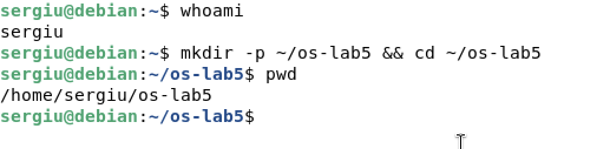

## Part 1. The tree and the file types

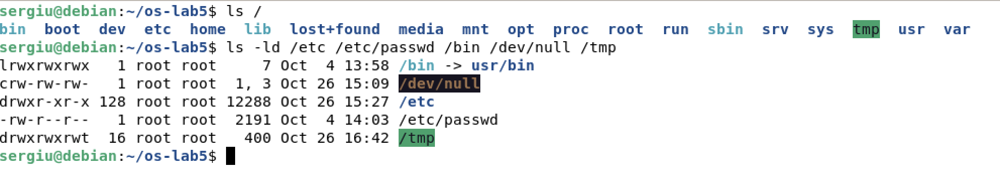

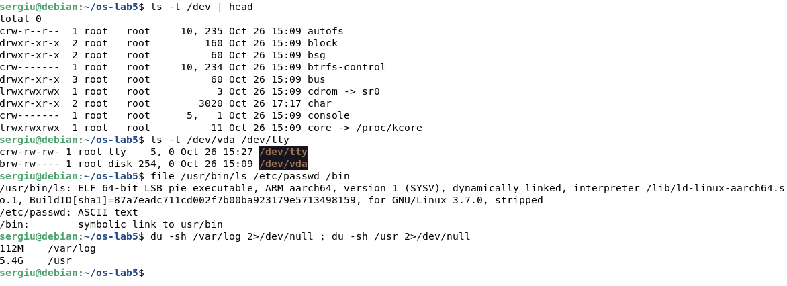

`ls -ld` shows one object per line, and the first character is the type: `d` directory, `-` regular file, `l` symbolic link, `c` character device, `b` block device (and `s`, `p` for sockets and pipes). For devices `ls` prints the major and minor numbers instead of a size; the major number selects the driver in the kernel. `file` looks at the content, not at the name.

### Observe

1. **Type of each path, from the first letter:**

   | Path | Letter | Type |
   |---|---|---|
   | `/etc` | `d` | directory |
   | `/etc/passwd` | `-` | regular file |
   | `/bin` | `l` | symbolic link |
   | `/dev/null` | `c` | character device |
   | `/tmp` | `d` | directory (with the sticky bit `t`) |

2. **What is `/bin`: a directory or a link, and to where?** On this system `/bin` is a symbolic link to `usr/bin` (relative, so it resolves to `/usr/bin`). This is the "merged `/usr`" layout: programs live in `/usr/bin` and the old path is kept for compatibility. `file` confirms it: `/bin: symbolic link to usr/bin`.

3. **One character device and one block device.** Character: `/dev/null` (or `/dev/tty`, `/dev/console`), accessed byte by byte, no fixed size. Block: `/dev/vda`, the virtual disk, accessed in blocks and partitioned. Instead of a size they show *major, minor* numbers, e.g. the ones in the figure.

4. **`/var/log` or `/usr` — which is bigger?** `/usr`: about 5.4 GB against 112 MB for `/var/log`, so roughly 49 times bigger. `/usr` holds every installed program and library, while `/var/log` holds only text logs that are rotated and compressed.

## Part 2. Inodes and links

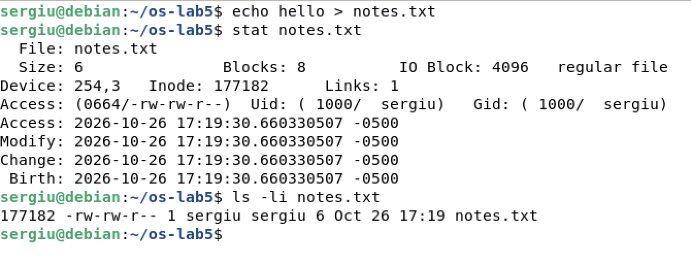

`stat` prints the inode record: type, size, blocks, device, inode number, link count, owner, group, mode and timestamps. The **name is not in the inode** — it lives in the directory. `ls -li` prints the inode number in its first column.

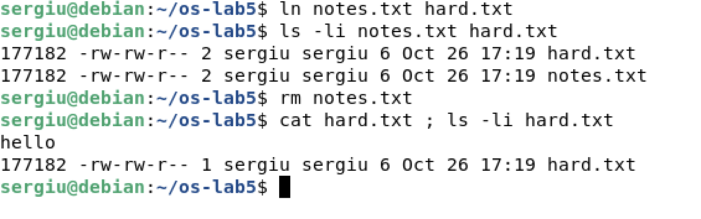

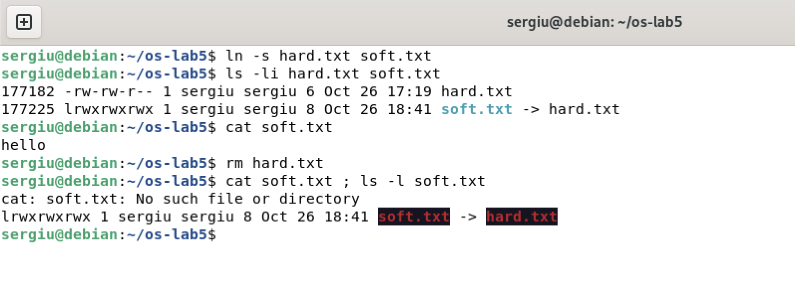

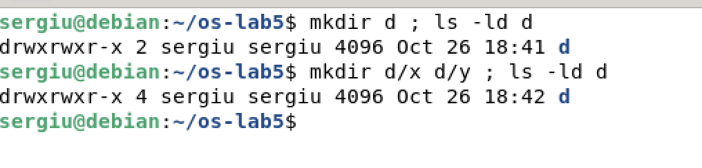

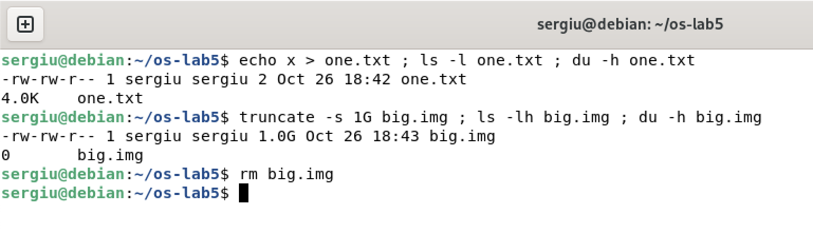

### Observe

1. **Which number in `stat` is the inode, and which counts the names?** `Inode:` is the inode number, and `ls -li` prints the same number in its first column. `Links:` is the number of directory entries that point to it, shown in the second column of `ls -l`.
2. **After `rm notes.txt`, why can `hard.txt` still be read? What does `rm` remove?** Both names pointed to the same inode, so the link count was 2. `rm` calls `unlink()`: it removes only the *name* from the directory and decrements the count. The count dropped to 1, so the inode and its data survived and stayed reachable through `hard.txt`. They are freed only when the count reaches 0 **and** no process has the file open.
3. **Why did `cat soft.txt` fail, and how big is `soft.txt`?** `soft.txt` is a separate inode that contains the path `hard.txt`. After `rm hard.txt` that path no longer exists, so `open` fails with `ENOENT` — the link dangles. Its size is exactly the length of the target string (`hard.txt`, 8 bytes); no terminating zero is stored.
4. **Where do the 2 and 4 links of a directory come from?** For `d`: (1) the entry `d` in its parent, (2) `d/.` inside itself; after `d/x` and `d/y`: (3) and (4) `d/x/..` and `d/y/..`. In general a directory has `2 + number of subdirectories` links.
5. **Why does a 2-byte file use 4.0K, and a 1 GB file use 0?** `ls -l` shows the size in the inode, `du` shows allocated space. ext4 allocates whole 4 KiB blocks, so 2 bytes occupy one block. `truncate -s 1G` only sets the size and writes nothing, so no block is allocated: the file is *sparse* and reads back zeros. Size and space are different things.

## Part 3. Permissions

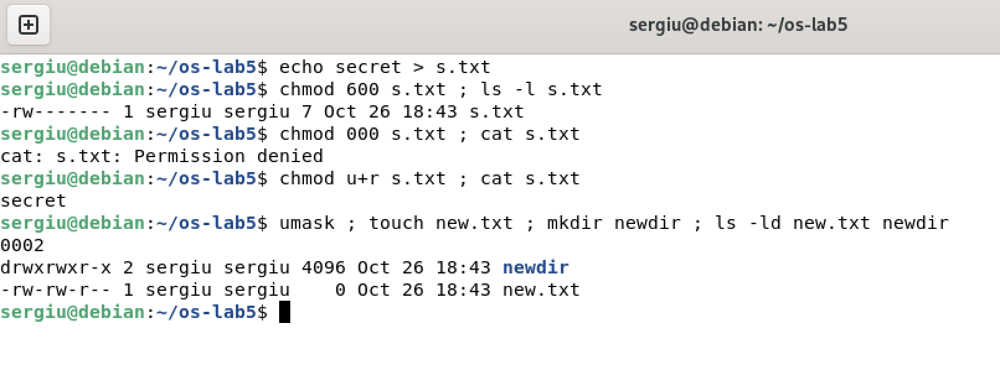

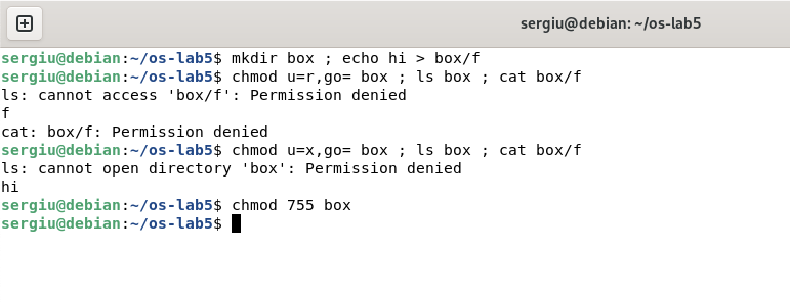

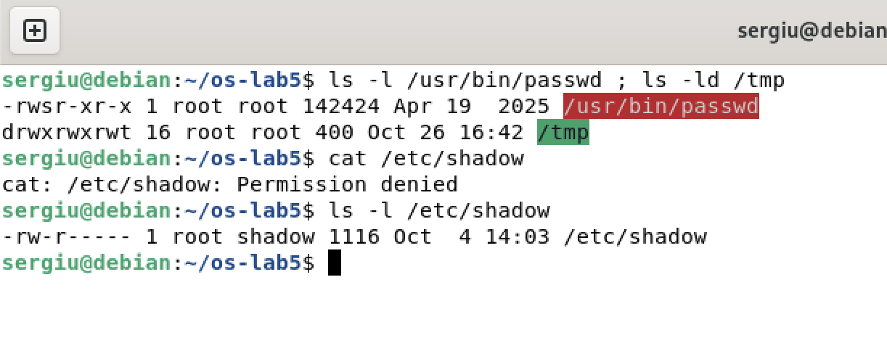

Prediction before the box experiment: with only `r` the names should be visible but the file unreachable; with only `x` the opposite. The output confirmed it.

### Observe

1. **600, 644, 755, 700 as rwx strings, with a use for each.**

   | Octal | String | Typical use |
   |---|---|---|
   | 600 | `rw-------` | private files: `~/.ssh/id_ed25519`, a password file |
   | 644 | `rw-r--r--` | documents and configs readable by all: `/etc/passwd`, a report |
   | 755 | `rwxr-xr-x` | programs and public directories: `/usr/bin/ls`, `/usr` |
   | 700 | `rwx------` | private directories or scripts: `~/.ssh`, a personal script |

2. **With `chmod 000` you own the file but cannot read it. Why?** The kernel checks only the bits of the class the process belongs to. My UID is the owner, so the *owner* bits are used, and they are `---`; the group and other bits are not consulted. Ownership grants the right to *change* permissions (that is why `chmod u+r` worked without `sudo`), not access. Only root bypasses the check.
3. **What is your umask, and how does it explain the new files?** `0002` removes write for *others*. `touch` requests `666`, so `666 & ~002 = 664` → `rw-rw-r--`; `mkdir` requests `777`, so `775` → `rwxrwxr-x`. Ubuntu uses `002` because every user has a private group. The exact values are in Figure 9.
4. **What does `r` allow on a directory, and what does `x`?** A directory is a table of (name, inode). `r` allows *reading that table*: `ls box` could print `f`, but `stat`/`cat` failed because reaching the inode needs `x`. `x` allows *traversing*: `ls box` failed, but `cat box/f` worked because the name was already known and the kernel was allowed to look it up. `w` allows creating and deleting entries.
5. **What do the `s` in `/usr/bin/passwd` and the `t` in `/tmp` mean?** `s` is **setuid**: the program runs with the effective UID of its owner, root, so it can write the new hash into `/etc/shadow`, which a normal user cannot even read (shown in Figure 11). The program limits each user to their own password. `t` is the **sticky** bit: everyone may create files in `/tmp`, but only the owner of a file (or of the directory, or root) may delete or rename it.

## Part 4. Disks and the kernel as files

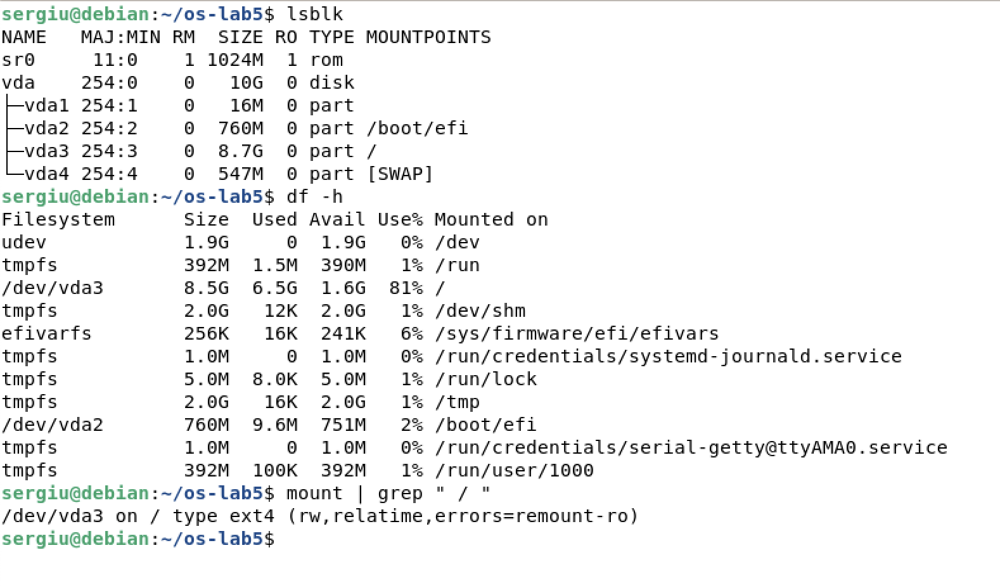

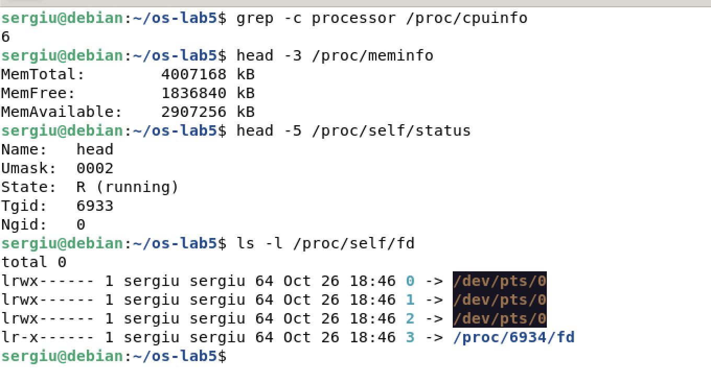

`lsblk` shows the block devices and where their partitions are mounted, `df -h` shows size, used, available and percentage per file system, and `mount` shows the attachment points and the file system type. `tmpfs` entries live in RAM, not on a disk. `/proc` is generated by the kernel when read: `cpuinfo` describes the processors, `meminfo` the memory, and `/proc/self` is a magic link to whichever process is reading it.

### Observe

1. **Draw your disk.** One 10 GB disk, `vda` (major 254), split into four partitions: `vda1` 16 MB (no mount point), `vda2` 760 MB vfat mounted on `/boot/efi`, `vda3` 8.7 GB ext4 mounted on `/`, and `vda4` 547 MB of swap. `sr0` is the empty virtual CD drive.
2. **How full is the root file system?** `/dev/vda3` has 8.5 GB, with 6.5 GB used and 1.6 GB available: 81 % full. Used plus available is slightly less than the size because ext4 reserves 5 % of the blocks for root.
3. **How many cores and how much RAM?** 6 cores, and `MemTotal` is 4 007 168 kB, about 3.8 GiB (4 GB assigned to the VM, minus what the kernel reserves).
4. **`/proc/self/status` showed the name of a program — which one, and why?** `head`. `/proc/self` always points to the process reading it, and the file was opened by `head`, not by the shell. For the same reason `ls -l /proc/self/fd` lists the descriptors of `ls` itself, including the descriptor of the directory it was listing.

## Stretch tasks

### (a) Magic numbers

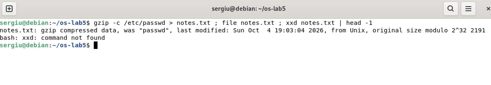

`file` ignores the `.txt` extension: it compares the first bytes with a database of signatures (visible in the hex dump). `1f 8b` is the gzip magic number, `08` is the compression method (deflate) and the next `08` is the "original file name present" flag, which is why the name of the original file appears right after the header.

### (c) Deleting a file that is still open

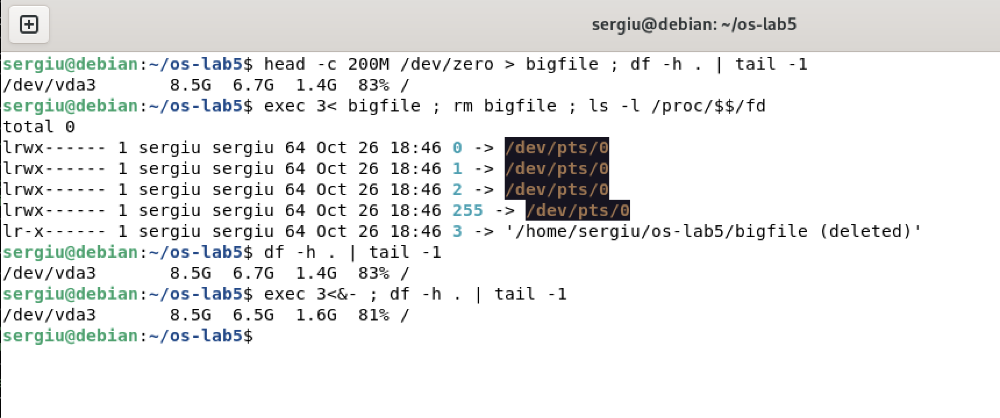

After `rm` the name is gone and the link count is 0, but the shell still holds descriptor 3, so `/proc/$$/fd` shows the old path with the suffix `(deleted)` and `df` still counts the space as used. Closing the descriptor with `exec 3<&-` frees it — the rule is "link count = 0 **and** no open references".

## Conclusion

The experiments made the separation between names and inodes concrete: `rm` only removes a directory entry, hard links keep the data alive, a symbolic link is a tiny file containing a path and breaks when that path disappears, and a directory collects one link from every subdirectory's `..`. The size of a file and the space it occupies are different things, because of block allocation and sparse files.

The permission part showed that the kernel applies exactly one class of bits, that ownership only lets you change permissions, that `r` and `x` mean "list" and "traverse" on a directory, and how the umask shapes every new file. setuid on `passwd` and the sticky bit on `/tmp` explained how users can do privileged and shared things safely. Finally, `lsblk`, `df` and `/proc` showed that disks, partitions and even the kernel's own state are just more parts of one tree.
