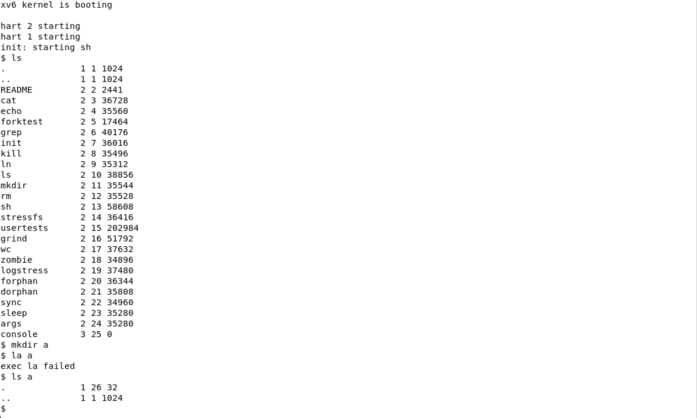
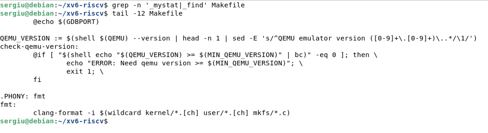
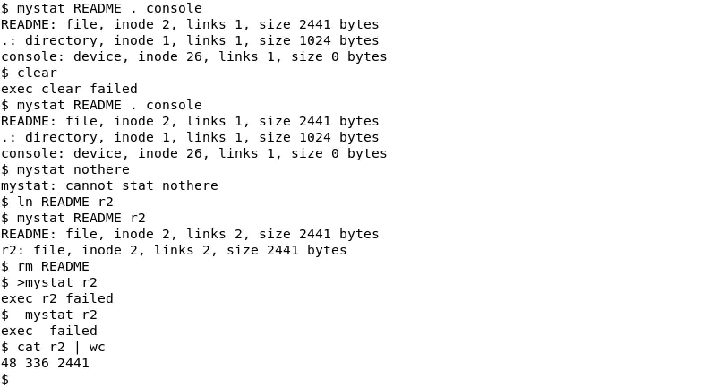
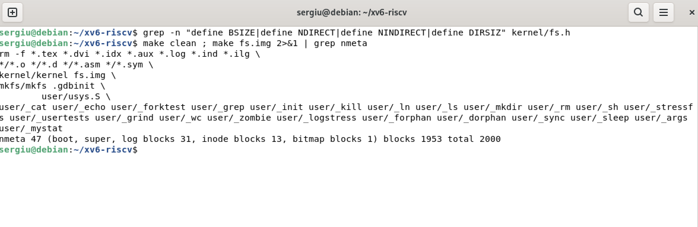
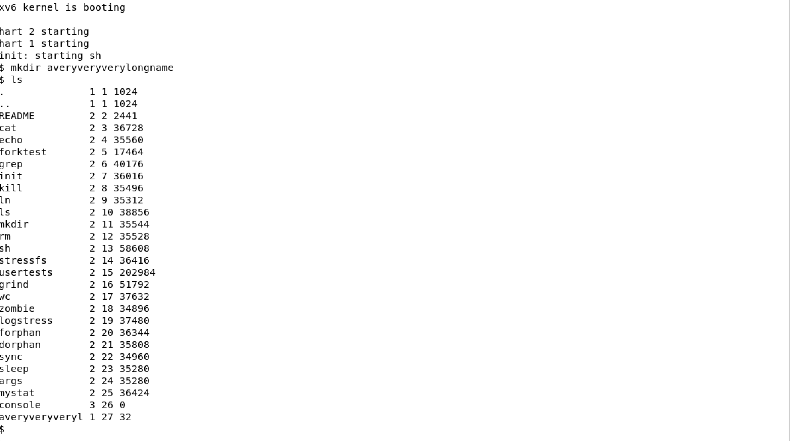
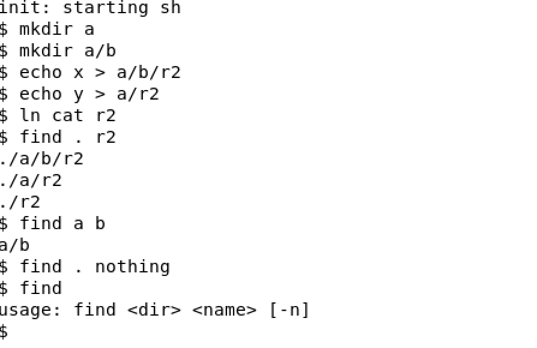
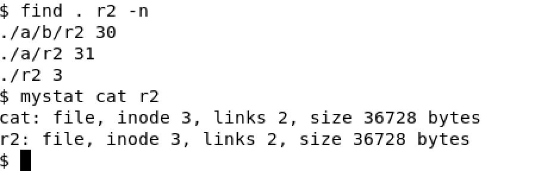

# Lab 6 · Inside the xv6 File System

**Sergiu Gherasim, FAF-242** · Technical University of Moldova, FCIM · Operating Systems · Laboratory work no. 6

The formatted report is [`lab6-report.tex`](lab6-report.tex) (LaTeX; figures are in `screenshots/`).
The source files for this lab are [`mystat.c`](mystat.c), [`find.c`](find.c) and the [`Makefile`](Makefile) with the new `UPROGS` lines.

## Purpose of the work

- Decode what the xv6 `ls` prints: type, inode number and size of every directory entry.
- Write `mystat`, which prints the fields of `struct stat`, and use it to watch hard links at work.
- Find the limits of the xv6 file system in `kernel/fs.h` and in the disk layout printed by `mkfs`.
- Write `find`, which walks the directory tree recursively (the MIT 6.1810 util lab).

Everything was done in the same `~/xv6-riscv` tree as the previous labs, inside QEMU (exit with `Ctrl-A` then `X`). Every new program is a file `user/NAME.c` plus a line `$U/_NAME\` at the end of `UPROGS` in the `Makefile` (a TAB at the start, nothing after the backslash).

## Part 1. Read what xv6 shows you



Each line of `ls` is: name, type, inode number, size in bytes. The type is decoded in `kernel/stat.h`:

```c
#define T_DIR    1 // Directory
#define T_FILE   2 // File
#define T_DEVICE 3 // Device

struct stat {
  int dev;     // File system's disk device
  uint ino;    // Inode number
  short type;  // Type of file
  short nlink; // Number of links to file
  uint64 size; // Size of file in bytes
};
```

### Observe

1. **What do types 1, 2 and 3 mean?** `1 = T_DIR` (directory), `2 = T_FILE` (regular file — `README` and every program), `3 = T_DEVICE` (device file — here only `console`, whose size is 0 because its data comes from the console driver, not from disk blocks).
2. **Which inode number does the root have, and why are `.` and `..` the same there?** The root is inode 1 (`ROOTINO` in `kernel/fs.h`; inode 0 is never used, because 0 marks a free directory slot). `.` always points to the directory itself, and the root has no parent, so `mkfs` makes its `..` point back to itself — that is why `cd ..` in `/` stays in `/`.
3. **An empty directory `a` has size 32. How big is one entry, and which two entries does `a` contain?** One `struct dirent` is 16 bytes: a 2-byte `ushort inum` and a 14-byte `char name[DIRSIZ]`. An "empty" directory still holds `.` (its own inode, the number shown for `a` in the first figure) and `..` (inode 1): 2 × 16 = 32 bytes.

## Part 2. Write mystat

The skeleton had two TODOs: translate the numeric type into a word, and call `stat()` for every argument, printing an error on descriptor 2 and continuing with the next argument.

```c
char *
typename(int t)
{
  switch(t){
  case T_DIR:
    return "directory";
  case T_FILE:
    return "file";
  case T_DEVICE:
    return "device";
  }
  return "?";
}
...
    if(stat(argv[i], &st) < 0){
      fprintf(2, "mystat: cannot stat %s\n", argv[i]);
      continue;
    }
    printf("%s: %s, inode %d, links %d, size %d bytes\n",
           argv[i], typename(st.type), st.ino, st.nlink, (int)st.size);
```

The program was added to `UPROGS`:



### Watching hard links at work



(The root directory reports `links 1`: `mkfs` gives the root inode one link, and in this freshly rebuilt image no subdirectory points back to it yet. After a `mkdir a` the count becomes 2, because `create()` in `kernel/sysfile.c` does `dp->nlink++` for every new subdirectory, to account for its `..` entry.)

### Observe

1. **Paste the outputs after `ln` and after `rm`. What changed and what did not?** After `ln README r2` both names report *the same* inode and the link count went from 1 to 2. After `rm README` the name `README` disappeared and `r2` still reports that inode, now with 1 link. What did **not** change: the inode number, the type, the size and the content — `cat r2 | wc` prints the whole README. `ln` and `rm` only add and remove directory entries and adjust `nlink`; the inode and its data blocks were never touched. The numbers are in the figure.
2. **Find the line in `kernel/sysfile.c` (`sys_unlink`) that decrements the link count. When are the data blocks freed?**

   ```c
     memset(&de, 0, sizeof(de));
     if (writei(dp, 0, (uint64)&de, off, sizeof(de)) != sizeof(de))
       panic("unlink: writei");
     if (ip->type == T_DIR) {
       dp->nlink--;
       iupdate(dp);
     }
     iunlockput(dp);

     ip->nlink--;
     iupdate(ip);
     iunlockput(ip);
   ```

   The decrement is `ip->nlink--;`. Before it, the directory entry is overwritten with zeros, which turns it into a free slot (`inum == 0`). `sys_unlink` frees **no** block. That happens in `iput()` in `kernel/fs.c`, reached through `iunlockput(ip)`: when the last in-memory reference is dropped (`ip->ref == 1`) **and** the link count is 0, `iput` calls `itrunc(ip)`, which frees all direct and indirect data blocks, and then marks the inode free. Blocks are freed only when no name and no open file refers to the inode — the same rule as on Linux in Lab 5.
3. **Which fields does an xv6 inode (`struct dinode`) have?**

   ```c
   struct dinode {
     short type;              // File type
     short major;             // Major device number (T_DEVICE only)
     short minor;             // Minor device number (T_DEVICE only)
     short nlink;             // Number of links to inode in file system
     uint size;               // Size of file (bytes)
     uint addrs[NDIRECT + 1]; // Data block addresses
   };
   ```

   Only six fields: `type`, `major`/`minor` (for devices), `nlink`, `size` and `addrs[13]` (12 direct block numbers plus one indirect block). Compared with ext4 there is no owner (UID/GID), no permission bits, no timestamps and no symlink type. The size is 4 × 2 + 4 + 13 × 4 = 64 bytes, so 16 inodes fit in one 1024-byte block.

## Part 3. Measure the limits

`kernel/fs.h` holds the constants that describe the geometry of the file system, and `mkfs` prints the layout it writes into `fs.img` at build time:



The same constants limit the names: `DIRSIZ` is 14, so a longer name is silently cut when the directory entry is written.



### Observe

1. **What does `ls` show for `averyveryverylongname`, and which constant explains it?** It shows `averyveryveryl`: the name was cut to its first 14 characters. The constant is `DIRSIZ = 14` — a `struct dirent` has room for exactly 14 bytes of name. `skipelem()` and `dirlink()` in `kernel/fs.c` copy only `DIRSIZ` bytes, and when the name is exactly 14 characters long there is no terminating zero in the entry; that is why `ls` copies the name into a buffer and adds `p[DIRSIZ] = 0` itself.
2. **Compute the largest file xv6 can hold.**

   ```text
   NINDIRECT = BSIZE / sizeof(uint) = 1024 / 4 = 256 block numbers
   MAXFILE   = NDIRECT + NINDIRECT  = 12 + 256 = 268 blocks
   max size  = 268 × 1024 = 274 432 bytes = 268 KiB
   ```

   A file bigger than 268 KiB cannot be written: `writei()` refuses to go past `MAXFILE * BSIZE`.

3. **From the `nmeta` line: how many blocks in total, and how many for the log, the inodes and the data?**

   | Region | Blocks | Where it comes from |
   |---|---|---|
   | boot + superblock | 2 | blocks 0 and 1 |
   | log | 31 | 1 header + `LOGBLOCKS` = 3 × `MAXOPBLOCKS` = 30 |
   | inodes | 13 | `NINODES`/`IPB` + 1 = 200/16 + 1 |
   | bitmap | 1 | 2000 bits fit in one block of 8192 bits |
   | **metadata (nmeta)** | **47** | 2 + 31 + 13 + 1 |
   | **data** | **1953** | 2000 − 47 |
   | **total** | **2000** | `FSSIZE` in `kernel/param.h` |

   The whole disk is 2000 blocks (about 2 MB): 31 for the log, 13 for the inodes, 1 for the bitmap and 1953 for data. The numbers come from the `nmeta` line in the figure.

## Part 4. Write find

`find.c` starts from `user/ls.c`: it opens a directory, reads `struct dirent` entries one by one, builds the full path in a buffer and calls `stat` on it. On top of that it

- skips entries with `inum == 0` (free slots);
- never follows `.` and `..`, otherwise the recursion would never end;
- compares the last component with `strcmp` and prints the full path on a match;
- recurses into directories;
- closes every directory it opens, because a process may have only 16 open files (`NOFILE`);
- with the optional third argument `-n` (stretch task) also prints the inode number of each match.

The full source is in [`find.c`](find.c).

### Testing on a fresh disk



The output contains exactly the three expected paths. The order follows the order of the entries in each directory: `a` was created before `r2` in the root, so the subtree of `a` is printed first. `find . nothing` prints nothing, and `find` without arguments prints the usage line on descriptor 2.

## Stretch: find with inode numbers



Only `./r2` is the same file as `cat`: `find . r2 -n` prints the same inode for both, and `mystat` shows that this inode has 2 links. `./a/r2` and `./a/b/r2` are new, independent files created by `echo`, which received fresh inodes. Running `./r2` would in fact start the `cat` program.

## Conclusion

In this lab I looked at the xv6 file system both from the shell and from the source code. A directory turned out to be literally an array of 16-byte entries, the root is inode 1 and its own parent, and `mystat` showed that `ln` and `rm` only change directory entries and the link count, while blocks are freed in `iput` only when the count reaches zero — the same rule as on Linux in Lab 5.

The limits in `kernel/fs.h` show how deliberately small xv6 is: 14-character names, 268 KiB files, and a 2000-block disk of which 47 blocks are metadata, including a 31-block log. Turning `ls` into a recursive `find` taught me to walk the tree safely — skip free slots and `.`/`..`, close every descriptor — and the stretch task confirmed once more that a name is only a pointer to an inode.
